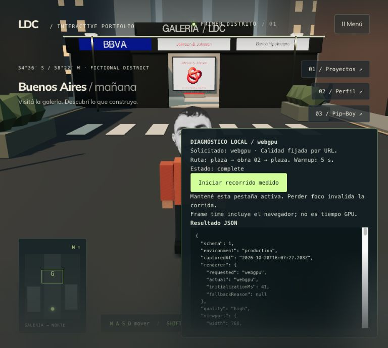

# DISTRITO — baseline de rendimiento y renderer

Fecha: 2026-10-20. Este documento distingue resultados medidos de objetivos y limitaciones.

## Protocolo reproducible

1. Usar Node compatible con Next 16 y ejecutar `npm run build -- --webpack`.
2. Servir ese build con `npm run start -- --hostname 127.0.0.1 --port 3101`.
3. Abrir `/es/city?benchmark=1&renderer=webgl&quality=high`.
4. Esperar que se habilite “Iniciar recorrido medido”. La foto y la fuente deben estar disponibles.
5. Mantener pestaña, tamaño y calidad fijos. El recorrido vuelve al spawn, espera 5 segundos, camina hasta la obra central usando el movimiento y las colisiones reales, abre el detalle durante 2 segundos, regresa y mide otros 2 segundos en la plaza.
6. Guardar el resultado JSON visible y repetir. Para WebGPU abrir la misma ruta con `renderer=webgpu`. Solo comparar si `renderer.actual` es `webgpu`; `webgl2-fallback` no cuenta como WebGPU.
7. Para calidad ligera repetir ambas rutas con `quality=low`. No mezclar sus resultados con calidad alta.

La ruta normal conserva WebGL y no muestra ni monta el panel o el muestreador. La implementación de WebGPU se importa dinámicamente solo al solicitarla. No se agregó telemetría ni se envían resultados fuera del equipo.

## Definición de las métricas

- FPS = cantidad de intervalos medidos / duración acumulada de esos intervalos. No es el promedio de FPS instantáneos.
- p50 y p95 usan percentil por rango más cercano. Los intervalos provienen del bucle real y no del delta acotado que usa el controlador del personaje.
- Los contadores se leen antes de renderizar el siguiente frame, con reinicio manual de `renderer.info` para incluir los pases de sombra. WebGL usa `render.calls`; el renderer nuevo usa `render.drawCalls`.
- Geometrías y texturas son cantidades de recursos activos. No equivalen a MB de VRAM.
- `heapBytesFirst/Last` usa la API opcional `performance.memory`. Si no está disponible se registra `null`. No es memoria total de la pestaña y sin controlar el recolector no prueba una fuga.
- Recursos listos es el tiempo desde navegación hasta disponibilidad de foto y fuente. No incluye una prueba controlada de carga por Internet ni certifica que todos los shaders estén calientes.
- Transferencia usa Resource Timing del mismo origen y el documento. Se informa caché y recursos con transferencia cero; las sumas no son una estimación universal del bundle en carga fría.
- No se mide tiempo GPU ni CPU puro. El intervalo incluye ritmo de presentación, trabajo de navegador y posibles pausas del sistema.

Una corrida abortada por pérdida de foco, desviación de ruta o timeout se conserva como inválida y no se usa para decidir rendimiento.

## Resultados y decisión

Build medido: `vO1LduuKGw7rnQ4IrX86E`, Next 16.1.1 / Three.js 0.182.0. Navegador integrado con UA Chrome 155 en macOS, 8 procesadores lógicos informados. El modelo físico de CPU/GPU no se identificó: no se deduce del user agent ni se da por validado otro dispositivo.

Todas las corridas usaron viewport 768 × 690, buffer 922 × 828, DPR informado ≈ 1.2 y preset alto. Se hicieron tres corridas consecutivas WebGL y después tres WebGPU; no se aleatorizó el orden ni se vació la caché. Cada corrida tuvo calentamiento inicial de 5 segundos; la primera visita a un material puede aún compilar shaders. No es una prueba de FPS máximos sin sincronización de presentación.

Se comparan la misma escena y el mismo preset, pero cada backend implementa sus propios pases de salida y sombras. No es un microbenchmark de APIs con un pipeline idéntico ni una comparación visual píxel a píxel.

| Backend real | Corrida | FPS | Frame p95 (ms) | Draw calls p95 | Triángulos p95 |
| --- | --- | --- | --- | --- | --- |
| WebGL 2 | 1 | 74.98 | 15.3 | 206 | 26,160 |
| WebGL 2 | 2 | 74.97 | 14.5 | 206 | 26,160 |
| WebGL 2 | 3 | 74.97 | 15.0 | 206 | 26,160 |
| WebGPU | 1 | 74.98 | 15.8 | 207 | 26,161 |
| WebGPU | 2 | 74.97 | 14.3 | 207 | 26,161 |
| WebGPU | 3 | 74.97 | 13.6 | 207 | 26,161 |

Mediana entre corridas: WebGL 74.97 FPS / p95 15.0 ms; WebGPU 74.97 FPS / p95 14.3 ms. Ambos completaron el mismo trayecto y el backend WebGPU fue real, sin fallback. El p95 mediano de WebGPU fue 0.7 ms menor, pero el rango de sus repeticiones (13.6–15.8 ms) se superpone con WebGL (14.5–15.3 ms). No se observó incremento de FPS y la metodología no permite atribuir una ganancia general al renderer.

Decisión: conservar WebGL como predeterminado. WebGPU queda disponible por URL para volver a medir cuando exista arte final, efectos o cargas que justifiquen cambiarlo. No migrar el Pip-Boy ni reemplazar motores a partir de esta única prueba.

### Carga y recursos

- Primera navegación WebGL: recursos de escena disponibles a los 853.3 ms desde navegación. Se reportaron 1,231,971 bytes de transferencia incluyendo documento/cabeceras y 1,216,186 bytes de cuerpos de recursos. Es localhost sin perfil de red impuesto; no valida el objetivo de carga fría por WAN.
- La foto `/profile.png` representa 583,733 bytes de cuerpo, aproximadamente 48% del total de cuerpos reportado en esa navegación. Oportunidad: generar un recurso de cara optimizado para el juego, conservando el original usado en otras páginas. No se modificó la foto en esta entrega.
- La navegación WebGPU reutilizó caché (22 recursos con transferencia cero); sus 159,203 bytes transferidos no son comparables como si fueran una carga fría. Apareció un chunk adicional de 146,344 bytes de cuerpo comprimido. Se informan los detalles en su JSON.
- Inicialización de la factory, incluyendo importación cuando corresponde: 6.7 ms WebGL y 41.0 ms WebGPU. Tampoco equivale al tiempo de carga fría completo.
- Máximos de recursos registrados: 129 geometrías/4 texturas en WebGL y 128/6 en WebGPU. Los backends tienen contabilidad diferente; no se interpreta esa diferencia como memoria ahorrada. Esos máximos permanecieron iguales entre las tres repeticiones de cada backend.
- El heap JS disponible fluctuó entre muestras, compatible con actividad del recolector. No se fuerza GC y no se concluye ausencia de fugas ni ventaja de memoria de un renderer.
- Los p95 de frame cumplen el objetivo provisional de ≤ 20 ms solo en esta configuración. Las 206–207 llamadas contando sombras superan ligeramente el presupuesto orientativo de 200: reservar margen antes de ampliar el distrito y medir materiales compartidos, geometría reutilizada y sombras estáticas cuando se produzca el arte final.

### Evidencia

- [Resumen y build ID](benchmarks/2026-10-20-summary.json)
- WebGL: [corrida 1](benchmarks/2026-10-20-webgl-high-1.json), [corrida 2](benchmarks/2026-10-20-webgl-high-2.json), [corrida 3](benchmarks/2026-10-20-webgl-high-3.json).
- WebGPU: [corrida 1](benchmarks/2026-10-20-webgpu-high-1.json), [corrida 2](benchmarks/2026-10-20-webgpu-high-2.json), [corrida 3](benchmarks/2026-10-20-webgpu-high-3.json).

### Próximo trabajo

1. Preparar el recurso fotográfico del personaje a una resolución/formato acordes al juego y medir su transferencia y calidad.
2. Producir una esquina de arte final y el personaje, presupuestando materiales, texturas, colisionadores y sombras.
3. Repetir el protocolo sobre esa muestra y ampliar a escritorio con GPU integrada y teléfono real, con viewport mayor y red limitada. La matriz de dispositivos, el preset ligero y el fallback de WebGPU aún requieren verificación.

## Límites del alcance

Esta primera medición es local y corresponde al navegador/equipo identificados en cada JSON. No establece rendimiento en teléfono físico, una matriz de navegadores ni carga fría con red limitada. Los presupuestos de `ROADMAP.md` continúan siendo objetivos hasta validarlos bajo esas condiciones.

## Escena posterior: galería porteña y retrato WebP

Build `3YFd3MCG20ucXsXd0716I`. Evidencia: `benchmarks/2026-10-20-porteno-webgl-high-1.json`. Una corrida de producción WebGL 2 completa, calidad alta, viewport/buffer 1280 × 720 y DPR 1: 74.97 FPS, p95 14.3 ms, máximo 23.5 ms; draw calls p95 227, triángulos p95 40742, geometrías máximo 147 y texturas máximo 6. El recorrido abrió la ficha y volvió a la plaza sin abortar.

Esta resolución difiere del baseline anterior (768 × 690 / buffer 922 × 828). Por tanto no se afirma una mejora de FPS ni una regresión de tiempos frente a él. La fachada agrega geometría y dos texturas procedurales; las instancias limitan sus llamadas de dibujo y se redujeron las luces de calle de seis a dos. Una sola corrida tampoco reemplaza la matriz de dispositivos.

Resource Timing confirma `face-mask.webp` con cuerpo de 35228 bytes y no incluye `profile.png`. La reducción del retrato respecto del original es 93.97 %; es ahorro de archivo, no de toda la descarga ni de FPS. La corrida reutilizó 18 recursos de caché y sirvió desde localhost: sus 714.9 ms de recursos listos no representan carga fría por Internet. No se repitió la comparación WebGPU después de este cambio de arte.
