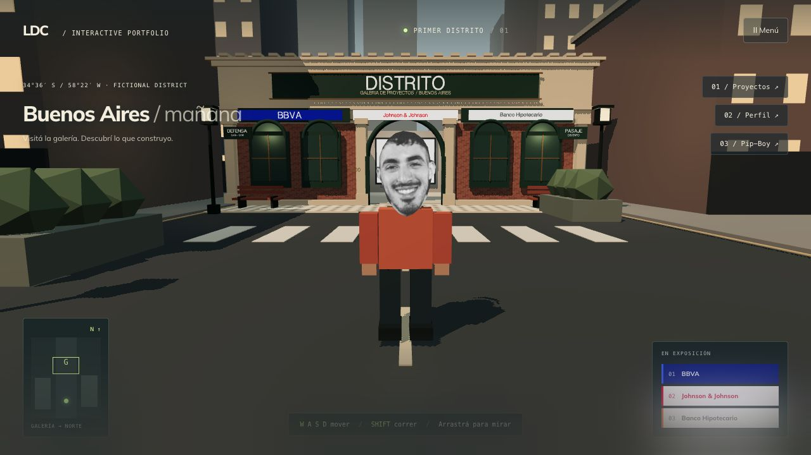
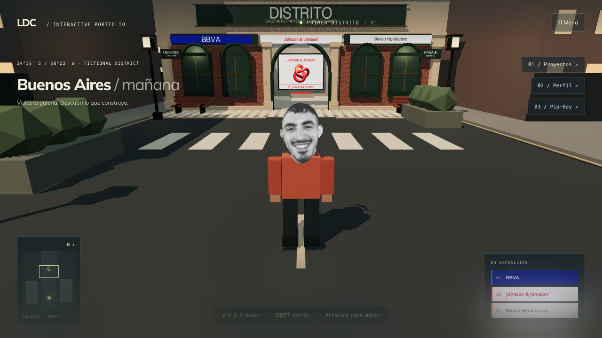

# Galería porteña y careta optimizada

Entrega del 20 de octubre de 2026. Todo el trabajo y la evidencia permanecen dentro de PORTFOLIO.

## Dirección visual implementada

Fachada inspirada en comercios de San Telmo: mampostería crema, ladrillo visto, carpintería verde oscuro, arco de acceso abierto, ventanas arqueadas con crucetas de bronce, cornisas y dentículos. El cartel DISTRITO, la numeración 1200 y las placas de Defensa/Pasaje Distrito completan el frente ficticio. Las tres empresas conservan sus colores propios; sus nombres siguen siendo texto, no archivos de logotipos oficiales.

La vereda tiene baldosas geométricas, cordón con paso central libre, bancos de madera y hierro y faroles de luz cálida. Los seis faroles comparten geometrías/materiales por instancias; solo los dos del acceso agregan luz puntual. Nueve lotes reúnen los detalles repetidos de la esquina. Ladrillo y pavimento se generan localmente en texturas de 256 × 256; no requieren imágenes externas. Materiales y texturas propios se liberan al desmontar.

Bancos y bases de faroles tienen colisiones en `world.ts`. El recorrido central y la entrada mantienen su contrato; no se agregó física ni se cambió de renderer. El resto del distrito y el personaje siguen siendo provisionales.

## Foto original y recurso de ejecución

- Original conservado: `public/profile.png`, 601 × 871, 583733 bytes.
- Recurso de la ciudad: `public/city/textures/face-mask.webp`, 384 × 557, 35228 bytes.
- Reducción del archivo: 93.97 %. No significa esa misma mejora de FPS.
- Reproducción: `npm run assets:city`, usando Sharp ya instalado por Next. No se instalaron dependencias.
- Informe y SHA-256 del original: `2026-10-20-portrait-optimization.json`. El script comprueba que el original no cambió durante la generación y rechaza dimensiones incompatibles con el contorno UV.

La careta y el diagnóstico cargan el mismo WebP desde `assets.ts`; las coordenadas UV del contorno original se conservan. La cara fue revisada de frente en el navegador de producción: mantiene rasgos reconocibles, contorno y orientación. Es compresión con pérdida, no una garantía de equivalencia píxel a píxel.

## Validación

31 tests aprobados, incluidos bancos, faroles y recorrido central. ESLint de la ciudad y del script de optimización aprobado, TypeScript global aprobado y build de producción con Webpack aprobado. Sigue la advertencia preexistente de Next sobre `middleware`.

Recorrido automático de producción completado: ida, apertura de ficha real central, regreso y cooldown. No hubo errores de consola en la revisión final. El Resource Timing registra el WebP de 35228 bytes y no carga `profile.png` en esa ruta. Una corrida local WebGL en calidad alta, 1280 × 720 y DPR 1 dio 74.97 FPS, p95 14.3 ms, draw calls p95 227 y triángulos p95 40742 (incluye sombras). Ver JSON e interpretación en `PERFORMANCE.md`; no es una comparación controlada con la resolución anterior ni una prueba en móvil físico.

