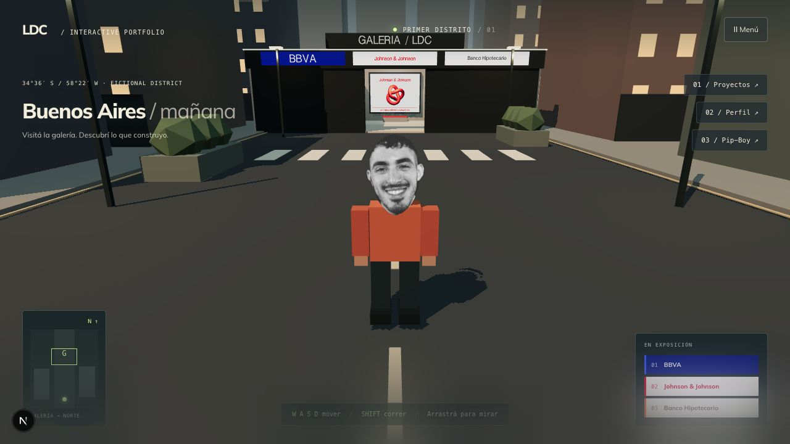
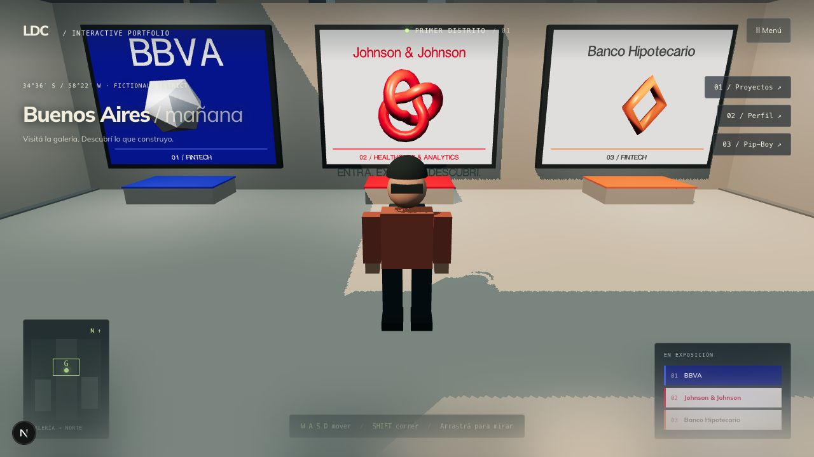

# DISTRITO — verificación del 2026-10-20

## Actualización: baseline y renderer

28 tests, TypeScript global, ESLint de la ciudad y build de producción Webpack aprobados. Se ejecutaron tres recorridos completos WebGL y tres WebGPU reales, con viewport y calidad idénticos. WebGL permanece predeterminado. [Informe, alcance, decisión y datos crudos](PERFORMANCE.md).

## Actualización: careta fotográfica

ESLint de los dos módulos de escena afectados y TypeScript global aprobados. En navegador se recargó la escena y se probó caminar hacia y en contra de la cámara: el frente muestra la foto y el reverso el cartón. La foto original conserva sus dimensiones de 601 × 871 y no se modificó. No se repitieron el build ni los tests de colisiones para este cambio visual.

## Alcance

Identidad por empresa y base técnica del prototipo. Las modificaciones y los artefactos de esta entrega se guardaron dentro de PORTFOLIO.

## Resultados

- TypeScript global: aprobado con `tsc --noEmit --incremental false`.
- ESLint de la ciudad, su ruta, el runner y los dos componentes corregidos: aprobado sin errores ni advertencias.
- `scripts/test-city.mjs`: 17 pruebas aprobadas. Incluye el contrato de identidades en español e inglés y las colisiones de los pedestales.
- Build Next.js 16.1.1 con Webpack: aprobado; compilación, TypeScript, generación de páginas y trazas completadas. El compilador informó 19.8 segundos para su etapa de compilación; no es una medición del tiempo total ni de rendimiento del juego.
- El intento con el bundler predeterminado Turbopack se interrumpió sin resultado concluyente. No se cambió el bundler predeterminado en `package.json`.
- Advertencia existente durante el build: Next recomienda migrar la convención `middleware` a `proxy`. No se incluyó esa migración en esta entrega.

Para Next se utilizó el runtime Node provisto por el entorno de trabajo. El Node 18 predeterminado de la terminal no satisface el requisito de Next 16; los comandos del README requieren Node 20.9 o posterior.

## Prueba manual en navegador

En el navegador integrado, con vista de 1280 × 720 y calidad alta:

1. Se ingresó desde la plaza y se recorrió la galería.
2. Se abrió Johnson & Johnson con E: contenido correcto e identidad roja.
3. Se cerró con Escape y se avanzó hasta BBVA: contenido correcto y cabecera azul.
4. Se recorrió hasta Banco Hipotecario: contenido correcto e identidad naranja.
5. Se comprobó la vista conjunta de las obras y la guía de empresas.

## Correcciones de base

`ColorSlider.tsx` recibió tipos de props y evento de cambio, conservando el callback opcional. `PipBoyColorContext.tsx` recibió tipos de estado, hijos y contexto; conserva `undefined` cuando no hay proveedor, como antes. La búsqueda de usos no encontró consumidores externos de esos dos módulos.

## Pendiente

No se midieron FPS, tiempo GPU, memoria o transferencia en esta entrega. No se compararon renderers, no se verificó touch físico ni la matriz de navegadores y no se publicó en producción. El personaje y la arquitectura continúan siendo provisionales. Las paletas provienen de las referencias del usuario; no se certifican como valores de manuales oficiales y los nombres en carteles no son archivos de logotipo.

## Ampliación: esquina porteña y textura optimizada

Esta sección actualiza el alcance histórico anterior: 31 tests, lint, TypeScript y build Webpack aprobados después de implementar la nueva fachada y el WebP. Se verificaron en producción la cara de frente, fachada completa y recorrido hasta la ficha central. Evidencia, conservación del original y límites en [PORTENO-CORNER.md](PORTENO-CORNER.md). La medición local nueva está en PERFORMANCE.md; siguen pendientes móvil físico y red limitada.
